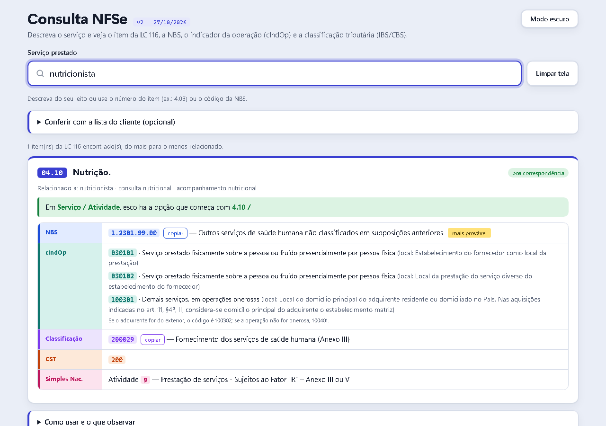

# Consulta NFSe

Ferramenta de apoio para escritórios de contabilidade: o usuário digita o serviço prestado (com as próprias palavras, por exemplo "serviços administrativos", "exame de sangue", "conserto de ar-condicionado") e a página mostra os códigos para preencher a NFS-e no contexto da Reforma Tributária (IBS/CBS):

- item da LC 116 e o que escolher no campo **Serviço / Atividade**;
- **NBS** (com a mais provável em destaque, na área da saúde);
- **cIndOp** (indicador da operação);
- **classificação tributária (cClassTrib)** e **CST**;
- código de atividade do **Simples Nacional**, quando a tabela traz.

É um único arquivo HTML. Funciona **offline**, sem servidor, sem API e sem custo por consulta, e não envia dados para lugar nenhum. Cada colega abre o arquivo no navegador.

> **Aviso:** ferramenta de apoio. A própria Receita trata o Anexo VIII como trabalho preliminar, sujeito a alterações. O vocabulário de busca foi montado com ajuda de IA e **não passou por revisão fiscal formal**. A decisão final sobre o enquadramento de cada serviço é do contador.

## Fontes oficiais

Portal Nacional da NFS-e, documentação técnica RTC:
<https://www.gov.br/nfse/pt-br/biblioteca/documentacao-tecnica/rtc>

| Documento | Versão em uso |
|---|---|
| Anexo VIII (correlação item LC 116 × NBS × cIndOp × cClassTrib) | v1.02.00 (26/10/2026) |
| Anexo VII (indicadores de operação, cIndOp) | v1.03.00 (NT 009) |

As planilhas originais estão em `dados/oficial/`.

## Como funciona

```
planilhas oficiais (.xlsx)
   └─ src/normaliza_anexo8.py / normaliza_anexo7.py  → dados/processado/*.csv
        └─ src/gerar_json.py                          → dados/processado/dados.json
             └─ src/montar_pagina.py (+ vocabulario.py + template.html) → dist/Consulta NFSe - vX - DD-MM-AAAA.html
```

A busca não usa IA em tempo de execução. A IA foi usada uma vez para escrever o vocabulário de termos populares de cada item (`src/vocabulario.py`). A página faz a busca no navegador com normalização de acentos, radical das palavras (singular/plural/gênero), peso por raridade do termo (IDF), tolerância a erro de digitação e avisos para o que não é ISS (por exemplo, restaurante e venda de roupas são ICMS).

Pontos de atenção do Anexo VIII que o código trata:
- células mescladas (o valor vale para todas as linhas cobertas);
- linhas de continuação sem NBS (o cIndOp pertence à última NBS do mesmo item);
- uma NBS pode ter mais de uma classificação tributária (a página lista todas);
- só valem as combinações item × NBS que existem na tabela.

Regra da aba "REGRA OP NÃO ONE_EXT" (Anexo VIII): o cIndOp da tabela vale para operação onerosa com adquirente no Brasil. Para adquirente no exterior ou operação não onerosa, o código muda (100301 → 100302 ou 100401, e assim por diante). A página mostra essa variante.



## Como usar

Abra o arquivo de `dist/` no navegador.

- **Busca:** digite o serviço com as suas palavras, o número do item da LC 116 (ex.: `4.03`) ou o código da NBS, com ou sem pontos (ex.: `1.2301.99.00`, ou só o início, como `1.2301`).
- **Lista do cliente (opcional):** cole as opções de "Serviço / Atividade" do sistema da prefeitura para ver exatamente qual linha escolher.
- **Limpar tela:** apaga a busca e a lista do cliente.
- **Modo claro / escuro:** botão no canto superior direito; a escolha fica salva no navegador.

## Como atualizar quando sair versão nova

1. Baixe as planilhas no portal e salve em `dados/oficial/`.
2. Rode:
   ```bash
   pip install -r requirements.txt
   python3 src/atualizar.py \
     --anexo8 "dados/oficial/Anexo VIII - v1.03.00.xlsx" \
     --anexo7 "dados/oficial/Anexo VII - v1.04.00.xlsx" \
     --versao "v3 - 29/10/2026"
   ```
3. Confira no terminal: quantidade de itens, pares item × NBS e a lista "sem descrição" (deve vir vazia).
4. Rode os testes (abaixo) e atualize a tabela de versões neste README.

O título da página e o nome do arquivo seguem o padrão `Consulta NFSe - v2 - 27/10/2026`.

## Testes

```bash
npm install
npx playwright install chromium
node testes/itens_e_lista_cliente.js "$(realpath dist/Consulta*.html)"
node testes/buscas.js "$(realpath dist/Consulta*.html)" "serviços administrativos" "mecânico" "ultrassom"
```

O primeiro teste abre todos os itens e verifica que cada um mostra NBS, cIndOp e classificação, e testa a conferência com a lista do cliente. O segundo imprime o resultado de buscas de exemplo.

## Estrutura

```
src/        scripts, vocabulário de busca e template da página
dados/      planilhas oficiais e CSV/JSON gerados
dist/       página final (arquivo único)
testes/     testes no navegador (Playwright)
docs/       notas de projeto
```

## Dados de clientes

Este repositório não contém notas fiscais, XMLs, PDFs nem listas de atividades de clientes reais. O `.gitignore` bloqueia essas extensões.

## Autoria

Desenvolvido por Romany Melo.

## Licença

[MIT](LICENSE). As planilhas em `dados/oficial/` são documentos públicos do Portal Nacional da NFS-e e seguem as condições da fonte.
